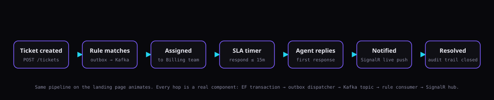

# ScaleDesk



## Support that runs itself.

Multi-tenant workspaces · SLA automation · Event-driven workflows · Real-time collaboration.

Built on **.NET 9 / Clean Architecture** with **Postgres RLS**, a **transactional outbox** feeding
**Kafka**, **Redis** cache-aside with graceful degrade, **SignalR** live updates, and a production
React 18 + Vite + Tailwind frontend you can click through in under five seconds.

---

## Try the demo — no install, no fixture data

Once the stack is up (see [Run it locally](#run-it-locally) at the bottom), the landing page has a
**Try the demo** button. One click provisions a session on the curated `demo` tenant — 12 tickets
across 4 priorities, 8 tagged customers, 3 SLA policies, one *visibly breached* ticket so the SLA
UI has something to show, and comment threads on the first three.

Under the hood it is `POST /api/auth/demo`, anonymous, IP rate-limited to 10 req/min, and returns
the exact same `AuthTokensResponse` shape a normal login would. The password never crosses the wire.

```bash
curl -sS -X POST http://localhost:5102/api/auth/demo | jq .
# → { "accessToken": "...", "refreshToken": "...", "expiresAt": "...", "user": { ... } }
```

If you want to inspect the seeded data without clicking anything:
`psql "host=localhost port=5433 user=scaledesk password=scaledesk dbname=scaledesk"` and filter
`TenantId` on the demo workspace slug `demo`.

---

## What this is

Not a CRUD scaffold. Not a To-Do app with a JWT bolted on. It's a support platform where the
interesting parts are all underneath:

- **Every state change emits a domain event, transactionally.** The outbox row commits with the
  aggregate; if Kafka is down, the write still succeeds and delivery resumes on reconnect.
- **Consumers are idempotent by design.** `processed_messages` has a unique index on the event id,
  so duplicate Kafka deliveries are no-ops, not bugs.
- **Tenant isolation is two independent layers.** EF global query filter + PostgreSQL RLS keyed on
  a session GUC. Neither one alone would be enough. Cross-tenant reads return **404**, not 403 —
  we don't confirm existence.
- **SLAs fire whether or not anyone is looking.** A background scanner ticks, emits
  `SlaBreached`, and the notification pipeline picks it up — same path as any other domain event.
- **Realtime without duplicating the write path.** SignalR is delivery-only. The DB is the source
  of truth; the hub just tells clients "something changed, refetch."
- **Auth that survives theft.** Refresh tokens rotate on every use; a replayed old token revokes the
  entire token family, not just the stolen branch.

---

## Architecture (short version)

```
Browser (React 18 + Vite + Tailwind + TanStack Query + SignalR)
    │
    ▼
ASP.NET Core 9 API  ──►  Application services (permissions, tenant guard)
    │                       │
    │                       ▼
    │                   EF Core 9  ──►  PostgreSQL 16
    │                   (global tenant filter)   (RLS on every tenant-owned table)
    ▼
Outbox ──► Kafka ──► Consumers (automation · SLA · notification)
                             │
                             ▼
                        Redis (cache-aside, degrades gracefully)
                             │
                             ▼
                        SignalR hub (delivery to connected clients)
```

Layers, strictly inward-pointing dependencies:

```
ScaleDesk.Domain          entities, enums, domain events — no dependencies
ScaleDesk.Application     use cases, contracts, ports (repositories, cache, notifier)
ScaleDesk.Infrastructure  EF + Npgsql, Redis, Kafka, SignalR, JWT, password hash, clock
ScaleDesk.Api             controllers, hub, health checks, DI wiring, Program.cs
web/                      Vite + React + TS + Tailwind + shadcn/ui + TanStack Query
```

Full write-up → **[docs/architecture.md](docs/architecture.md)**.

---

## Reliability — measured by trying to break it

The suite is not "unit tests that hit HTTP." Each scenario mutates the environment (kills a broker,
replays a stolen token, corrupts a due-date) and asserts the system's contract still holds at the
final durable state.

**7/7 chaos scenarios pass** (`ops/verification/`) · **27/27 unit tests** · **23/23 integration
tests** · **36/36 journey checks** (the J1–J5 role sweep) on the same build.

```
✓ Multi-tenant isolation        (EF global filter + Postgres RLS, both proven)
✓ PostgreSQL RLS                (least-privilege app role; default-deny; superuser bypass control)
✓ Kafka failure recovery        (broker killed mid-write → row persists → outbox buffers → drains → consumed)
✓ Transactional outbox          (no lost events across an outage; at-least-once)
✓ Event idempotency             (stable event-id dedup; duplicate re-delivery → processed once)
✓ Redis degradation             (cache down → reads fall back to Postgres → readiness Degraded → recovers)
✓ SLA breach processing         (timer scanner → event → notification; idempotent, never re-escalated)
✓ Refresh-token theft detection (reuse → 401 AND revokes the entire token family)
✓ Distributed tracing           (one W3C trace spans HTTP → outbox → Kafka → consumer)
✓ End-to-end ticket workflow    (create → DB → outbox → Kafka → automation → notification → SignalR)
```

Reproduce: `powershell -File ops/verification/run-all.ps1` ·
Method: [docs/failure-testing.md](docs/failure-testing.md).

---

## Performance — one bottleneck, one fix, 3.7× throughput

Stage 5D built the harness (~20 tenants × 50k tickets ≈ **1M rows** seeded, k6 ramp 1 → 500 VUs on
a realistic 40/25/10/10/5/5/5 mixed workload). Stage 5E landed the **one** fix the diagnosis
pointed at and re-ran the identical ramp.

| metric @ 50 VUs | BEFORE | AFTER | Δ |
|---|---:|---:|:-:|
| throughput | 45.8 req/s | **167.5 req/s** | **3.7×** |
| p95 latency | 3130 ms | **804 ms** | **3.9×** |
| ticket-list p95 | 3850 ms | **961 ms** | **4.0×** |

At the DB level, the hot query went from `Sort 401.9 ms / 37,226 buffers / 50k rows` to
`Index Scan 0.334 ms / 22 buffers / 20 rows` — roughly **1200× on the query itself**. The fix was
one EF Core line:

```csharp
b.HasIndex(x => new { x.TenantId, x.CreatedAt }).IsDescending(false, true);
```

Nothing else. No cache in front of the list, no read replica, no raw-SQL rewrite, no weakened RLS.
Full curve, EXPLAIN before/after, methodology, caveats: [docs/performance.md](docs/performance.md)
· raw artifacts under [`ops/load/results-before/`](ops/load/results-before/) and
[`ops/load/results/`](ops/load/results/).

---

## The frontend (Stage 5F.1 — this stage)

Seven screens live, dark-mode first, shadcn/ui + Radix primitives, TanStack Query for state,
SignalR wired into the ticket detail.

| Screen | What's real |
|---|---|
| **Landing** | Animated event-flow hero (Framer Motion), Try-the-demo CTA, feature grid |
| **Login / Register** | React Hook Form + Zod, calls `/api/auth/register` to provision tenant + admin in one shot |
| **App shell** | Sidebar (Overview · Tickets live; Customers · Teams · Automation · SLA · Analytics · Settings marked "5F.2"), top bar with notification bell + user menu |
| **Ticket list** | Server-paginated via the 3.9×-faster indexed endpoint, filter chips by status/priority, keyboard `n` for new |
| **Ticket detail** | Comment thread (customer · agent · internal styling), reply box with public/internal toggle, live SignalR updates from other tabs, SLA countdown badge computed from `responseDueAt` |
| **Dashboard** | 4 KPI cards + 14-day ticket-volume sparkline + recent tickets + unread notification preview. All from one `GET /api/dashboard/stats` call |
| **Try the demo** | `POST /api/auth/demo` → stores tokens → routes to `/app/tickets` scoped to the seeded `demo` tenant |

Backend deltas permitted by this stage: exactly **three** additions, all read-only or thin wrappers
around existing pipelines — no new subsystem, no new table, no cache, no Kafka topic:

- `GET /api/dashboard/stats` — three LINQ aggregates against the existing `tickets` table +
  `notifications.LongCountAsync`, tenant-scoped by the global filter.
- `POST /api/auth/demo` — `[AllowAnonymous] [EnableRateLimiting("auth")]`, calls the existing
  `AuthService.LoginAsync` with fixed `DemoWorkspace` credentials. Standard token pipeline,
  standard lockout, standard refresh rotation.
- `GET /api/tickets/{id}/comments` — completes the ticket aggregate's HTTP surface (the entity
  already had the `Comments` nav property; only the controller endpoint was missing).

Deferred to 5F.2 (visible in the sidebar, no screens yet): Customers list/detail, Teams, Automation
builder, SLA command center, Analytics, Settings, admin/health.

---

## Super Admin & Customer Portal (Stage 7)

Two more user surfaces beyond the agent workspace, each with its own JWT **scope**
(`staff` · `platform` · `portal`) confined by one choke-point guard middleware — a token only reaches
its own URL space, so all three sessions can coexist in the *same* browser (the two-window demo):

| Surface | Who | What's real |
|---|---|---|
| **`/platform` (ScaleDesk HQ)** | platform super-admin | cross-tenant stats + tenant list/detail; **suspend** a tenant → that tenant's staff login is hard-**403**'d (`tenant_suspended`), **resume** → restored |
| **`/portal`** | external customers | self-register by workspace slug (link-by-email to the tenant's `Customer`); file a ticket through the **same** intake pipeline (SLA stamping + outbox → automation fires for real); two-way thread where **internal notes stay invisible to the customer**; close-when-resolved; someone else's ticket is **404** (no row enumeration) |

Proven live end-to-end by `ops/verification/verify-journeys.ps1` — one J1–J5 sweep, **36/36 checks
green** against the running compose stack.

---

## Docs

| Doc | What's inside |
|---|---|
| [docs/architecture.md](docs/architecture.md) | Request pipeline, layers, two-layer multi-tenancy, reliability primitives, observability |
| [docs/performance.md](docs/performance.md) | 5D/5E arc compressed: setup, bottleneck, EXPLAIN, full BEFORE→AFTER curve, what we did NOT do |
| [docs/failure-testing.md](docs/failure-testing.md) | The 7 chaos scenarios, what each proves, reading order |
| [ops/load/FINDINGS.md](ops/load/FINDINGS.md) | Full narrative write-up of the load investigation |
| [ops/verification/README.md](ops/verification/README.md) | Chaos-suite method + evidence |

---

## Roadmap

```
5A–5B  Core backend + observability ............... done
5C     Failure / E2E verification ............... done   (7/7 chaos, ops/verification)
5D     Load testing (measured bottleneck) ....... done   (1M corpus, 10→500 VUs)
5E     Performance optimization ................. done   (one index, 3.7× peak throughput)
5F.1   Production frontend (this stage) ......... done   (landing + auth + tickets + dashboard + demo)
5F.2   Remaining screens (Customers · Teams · Automation · SLA · Analytics · Settings)
5G     Analytics / Big Data
5H     AI features
5I     AWS deployment
5J     Public beta
7      Super Admin · Customer Portal ............. done   (/platform HQ, /portal — 36/36 journey checks)
       Kubernetes manifests (k8s/) ................ committed   (validate offline; live minikube deferred)
```

---

## Run it locally

**Prereqs:** Docker Desktop, .NET 9 SDK, Node 20+.

### Full stack in dev mode (recommended)

```powershell
# Brings up data plane (Postgres + Redis + Kafka + Jaeger), starts the API on host
# at :5102 with auto-migrate + demo seed, and Vite on :5173 with a proxy to the API.
powershell -File ops/frontend/up-web.ps1
```

Open <http://localhost:5173> → click **Try the demo** → you're in the ticket list. The landing
page's animated hero is the same diagram shown at the top of this README, live.

### API only (no frontend)

```powershell
docker compose up -d                          # full topology, API on :8080
# seeded tenants: technova · acme · demo
curl -sS http://localhost:8080/health/ready | jq
```

### Full stack on Kubernetes

```powershell
# minikube cluster "scaledesk" (docker driver): builds api + web images in-cluster,
# applies k8s/base (postgres·redis·kafka·jaeger·api·web·ingress), waits for rollouts.
powershell -File ops/k8s/deploy.ps1           # -> http://scaledesk.local
powershell -File ops/k8s/teardown.ps1         # remove the stack again
```

Everything the compose file runs, runs in-namespace `scaledesk` — same env, same RLS role
bootstrap, PVCs instead of volumes. Topology map, the 1-replica-API rationale and the
EKS path are in [k8s/README.md](k8s/README.md).

> **Status note (honest):** the `k8s/` manifests + `ops/k8s/deploy.ps1` are complete and validate
> offline (`kubectl kustomize k8s/base` → 17 resources), but the **live** minikube bring-up is
> deferred — it repeatedly crashed this machine's Docker Desktop under cluster load, and the roadmap
> targets AWS App Runner / ECS (not EKS) for the real 5I cloud deploy anyway. Treat `deploy.ps1` as
> the runbook for a Docker-stable host; the day-to-day stack above is Docker Compose.

### Just the backend tests

```powershell
dotnet test -c Release                         # 27/27 unit + 23/23 integration
```

### Just the frontend build

```powershell
cd web
npm install
npm run build                                  # ~620 kB gz to ~192 kB, no warnings that matter
```

### Re-run the reliability suite

```powershell
powershell -File ops/verification/run-all.ps1 # expects 7/7
```

### Re-run the load harness

```powershell
dotnet run --project ops/load/seed -c Release  # ~3 min to seed 1M rows
powershell -File ops/load/run-load.ps1         # ~8 min ramp
```

**Windows note:** the data-service port mapping avoids a host Postgres already bound to `:5432`
(see `docker-compose.override.yml` — host port is `:5433`).

---

## Demo credentials (already seeded)

| Field | Value |
|---|---|
| Organization slug | `demo` |
| Email | `demo@scaledesk.app` |
| Password | `DemoPass2026!` |

The `Try the demo` button prefills and submits these; the login path is identical to any real user's
so nothing about the demo bypasses the auth pipeline.
